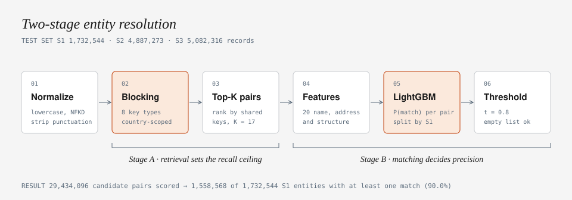
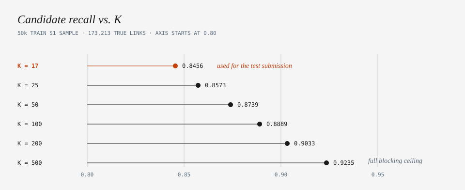
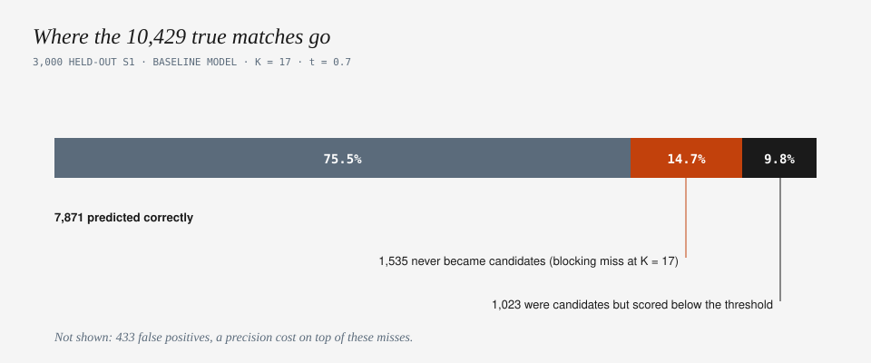
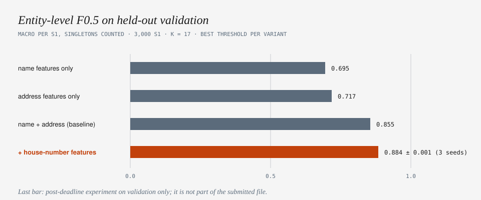

# Business Entity Resolution at Scale

**Find the same real-world business across three noisy sources: 1.7M reference records, about 10M candidates, no shared IDs.**
A two-stage pipeline (multi-key blocking, then a LightGBM matcher with an entity-level threshold) built for the Amazon ML Challenge 2026.

> **Status: finished project, competition closed.** I never saw a leaderboard score, so none is claimed here.
> Every number below was measured on a held-out validation split of the training data, and the limits of that measurement are listed in [Limitations](#limitations).



## At a glance

| | |
|---|---|
| **Task** | For every Source 1 business, find all matching records in Source 2 and Source 3 (zero, one, or many). Metric: per-entity F0.5, averaged over S1 entities, singletons included. |
| **Scale** | Test: 1,732,544 S1, 4,887,273 S2, 5,082,316 S3 records. Train: 2.2M S1, 5.0M S2, 5.3M S3. |
| **Submitted run** | 29.4M candidate pairs scored, 1,558,568 of 1,732,544 S1 entities received at least one match (90.0%). Passed the official format validator. |
| **Validation (entity F0.5, K = 17)** | **0.855** baseline, **0.884 ± 0.001** after the house-number fix (post-deadline, validation only). |
| **Hardware** | A free Kaggle CPU notebook (31 GB RAM, no GPU). No external data, APIs or lookups. |

## The problem in one example

The same business arrives from three sources with different typos, abbreviations and address formats:

```
S1   primary care specialists inc          141 08 71 road flushing ny
S3   primary care stpianlsts inc           141 08b 71 rd flushign new york
S3   primary care specialists incorporated 141 08b 71 rd flushign new york
```

Exact matching fails, and comparing every S1 record with every S2/S3 record is about 10^13 comparisons. So the pipeline first narrows the search (Stage A), then decides (Stage B).

## How it works

### Stage A: blocking (retrieval)

A matcher cannot recover a pair that blocking never proposed, so Stage A sets the recall ceiling.

1. **Normalize**: lowercase, Unicode NFKD with accents stripped, `&` becomes `and`, punctuation removed, whitespace collapsed.
2. **Index S2 and S3** with eight key types per record, scoped by country so a new country needs no code change:

| Key | Meaning |
|---|---|
| `NT` | each distinctive name token |
| `NP5`, `NP6` | 5- and 6-character prefixes of name tokens |
| `NE` | the whole normalized name |
| `NS` | name tokens sorted (survives word-order changes) |
| `AT` | each distinctive address token |
| `AP6` | 6-character prefix of address tokens |
| `AN` | house number + address token |

Generic words (`inc`, `llc`, `company`, ...) are stopwords, and any key shared by more than 1,200 records is dropped.
3. **Rank** each S1's candidates by how many independent keys they share and keep the top K.

### Stage B: matching

Each candidate pair gets 20 features, and a LightGBM classifier outputs P(match).

- **Name and address similarity (10 each):** RapidFuzz `WRatio`, `ratio`, token sort, token set, Levenshtein similarity.
- **Evidence flags:** exact match, missing value, length difference (per field).
- **Structure:** same country, shared name tokens, shared address tokens, candidate rank.

Training pairs come from 50,000 train S1 entities, **split by S1 entity** (not by row) so candidates of one entity never leak across train and validation. Negatives are the blocker's own near-misses, which makes them hard negatives by construction. The final answer for each S1 is every candidate above the threshold, so one S1 can have zero, one or many matches.

## Eight blocking experiments, one that worked

Blocking took most of the engineering effort. Seven of eight designs failed for concrete reasons:

| # | Strategy | Outcome |
|---|---|---|
| E1 | name prefix + address tail | about 24% recall, too brittle |
| E2 | broad multi-key | recall up, but about 4,600 candidates per S1 |
| E3 | phonetic (Soundex) index | memory blew up |
| E4 | character TF-IDF, brute-force nearest neighbours | too slow on 10M records |
| E5 | chunked TF-IDF | still too slow |
| E6 | generated character signatures | memory blew up |
| E7 | coarse character blocker | found 0 extra true pairs |
| **E8** | **the eight country-scoped keys above, ranked by shared keys** | **92.35% recall (159,970 of 173,213 true links) at about 482 candidates per S1** |

**Missed pairs were not hopeless.** Of the 13,243 true links E8 missed, 98.65% still had name *or* address similarity of at least 70. That finding is why the matcher uses name and address as complementary evidence, and the ablation below confirms it.

## Results

All numbers: 3,000 held-out S1 entities, per-entity F0.5 as in the competition, K = 17 candidates per S1 unless stated.

### 1. How many candidates to keep

The test run had to score 1.7M entities on a CPU, so I capped candidates at K = 17 (a 30M-pair budget). Recall falls with K, but the final score barely moves: entity F0.5 was **0.855 at K = 17, 0.860 at K = 50, 0.858 at K = 100**.



### 2. Name and address need each other

Either field alone is far weaker than both together.

| Features | Entity F0.5 |
|---|---|
| name only | 0.695 |
| address only | 0.717 |
| name + address | **0.855** |
| name + address without candidate rank | 0.854 |

The blocking rank adds about 0.1 point, which is within noise, so I do not claim it matters. The top features are `addr_tsort` (32% of gain), `addr_tset` (28%) and `name_wratio` (16%).

### 3. Where the remaining errors come from



About a quarter of true matches are lost: 14.7% never reach the matcher (a blocking limit, mostly from the K cap), and 9.8% reach it but score below the threshold.

### 4. A fix found through error analysis

The highest-scoring false positives were near-duplicates with **conflicting house numbers**: same name, `31704 74th avenue` versus `31706 74th ave`. I added six house-number features (overlap, one-sided numbers, Jaccard, an explicit conflict flag) and retrained with three seeds each.



| | Baseline | + house-number features |
|---|---|---|
| Entity F0.5 | 0.856 ± 0.004 | **0.884 ± 0.001** |
| Precision / recall | 0.948 / 0.756 | 0.973 / 0.780 |
| False positives (t = 0.7) | 433 | 289 |
| False positives with a number conflict | 226 | 29 |

The signal is strong: 6.0% of true matches have a house-number conflict versus 57.9% of non-matches. Precision and recall both improved, so this is not just a threshold trade-off.

### 5. Things that did not help

Capping matches per entity (top-3: 0.835) and keeping only candidates close to the best score (relative cutoff 0.9: 0.835) both scored below the 0.855 baseline. The matcher already handles entities with several true matches (about 3.5 on average).

## Limitations

Read these before quoting any number.

- **No leaderboard score.** The competition is closed and I never saw one.
- **Small validation set.** 3,000 S1 entities from the first 50k train S1 (one split, one seed for the main model). Early stopping and the threshold were chosen on the same set, so absolute numbers are slightly optimistic. Differences under about 0.5 points are noise.
- **The house-number model was never scored on the test set.** The submitted file came from the baseline model (K = 17, t = 0.8). The improvement was measured after the deadline, on validation only.
- **The submitted threshold was not the best one.** I tuned 0.8 on a pooled metric; under the official per-entity metric 0.7 scores about 0.9 points higher on validation (0.855 vs 0.846).
- **France is untested.** The test set contains a third country that is absent from the training data. The pipeline treats country as an open label and runs on it, but all validation is US and India.
- **A full-train run was abandoned.** Generating candidates for all 2.2M train S1 (218M rows) hit Kaggle's disk and memory limits, so the matcher was trained on the 50k-S1 sample.
- **K = 17 cost recall.** About 0.846 candidate recall versus 0.9235 at K = 500, though the end-to-end effect was small (see Results 1).

## Repository layout

```
.
├── README.md
├── requirements.txt
├── src/
│   ├── common.py               # paths, text normalization, chunked readers
│   ├── normalize.py            # raw TSV -> normalized TSV
│   ├── build_candidates.py     # Stage A: index S2/S3, top-K candidates per S1
│   ├── build_features.py       # Stage B: 20 pair features (+ optional house-number features)
│   ├── train_matcher.py        # label, split by S1, train LightGBM, sweep thresholds
│   └── generate_submission.py  # score candidates, write both output files
├── models/matcher_lgbm.txt     # the trained matcher (small enough to commit)
├── notebooks/                  # the original Kaggle notebooks (outputs cleared)
├── reports/                    # measured results (CSV/JSON) behind every number above
└── docs/diagrams/              # SVG diagrams (+ make_diagrams.py that generates them)
```

Raw data, candidate files and predictions are not in the repository (they are hundreds of MB, and the data is not mine to redistribute).

## Reproduce

1. Get the competition data (`train_source{1,2,3}.tsv`, `train_ground_truth.tsv`, `test_source{1,2,3}.tsv`) and put it in `data/`.
2. `pip install -r requirements.txt`
3. Run the stages in order (`--help` on any script lists its options). Paths default to `data/`, `work/`, `models/`, `output/`; set `ER_ROOT` to relocate them.

```bash
python src/normalize.py train
python src/build_candidates.py train --limit 50000 --k 500   # 50k-S1 training sample
python src/train_matcher.py                                  # add --house-number for the 26-feature model
python src/normalize.py test
python src/build_candidates.py test --k 17
python src/generate_submission.py --threshold 0.8            # the threshold submitted; train_matcher prints the best one
```

4. Validate with the competition's `validate_submission.py` (not included here, it belongs to the organisers):

```bash
python3 validate_submission.py --matching output/matching_results.tsv \
    --candidate output/candidate_pairs.tsv --test-dir data/test
```

Memory note: indexing S2 and S3 holds about 15M keys each in a Python dict, which needed several GB. Candidate generation streams to disk, and scoring runs in 300k-pair chunks.

## Credits

- **Dataset:** provided by Dharmi Sapariya (shared privately on Kaggle). It is not included in this repository.
- **Features:** built by Jasmine - normalization, blocking, features, model, evaluation, error analysis, diagrams.

Built for the Amazon ML Challenge 2026; this project is not affiliated with Amazon. Code released under the MIT license.
